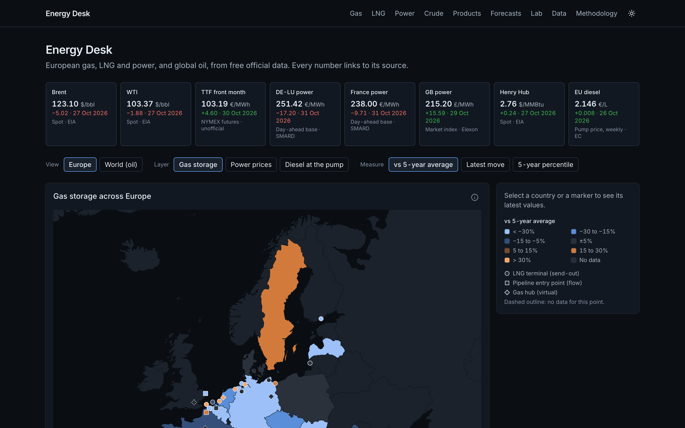
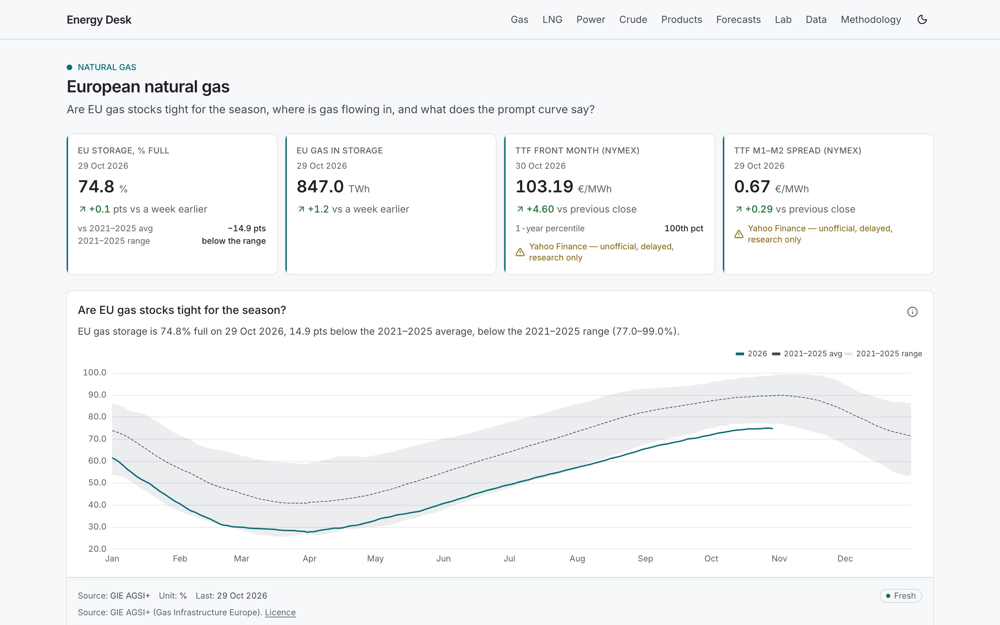
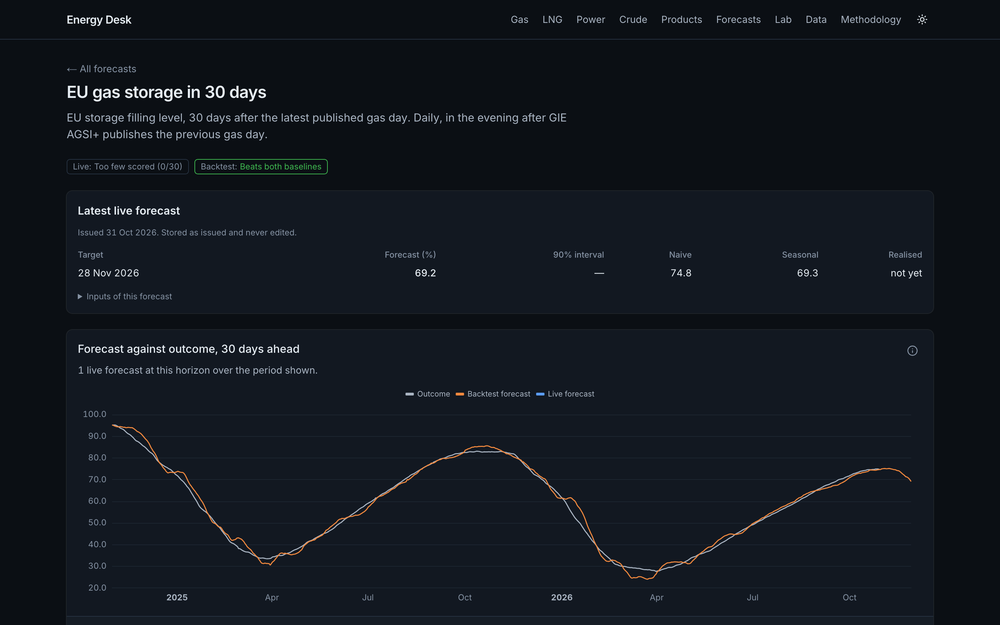
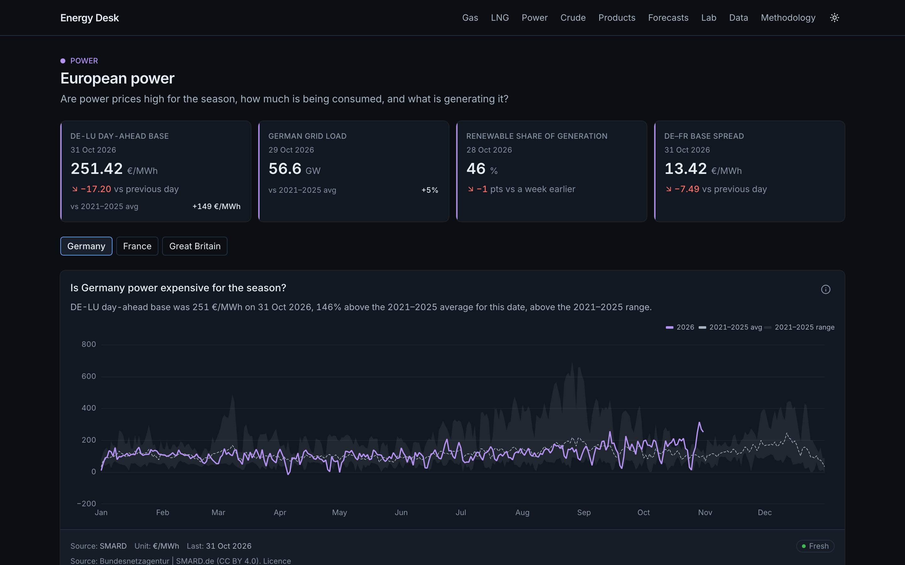
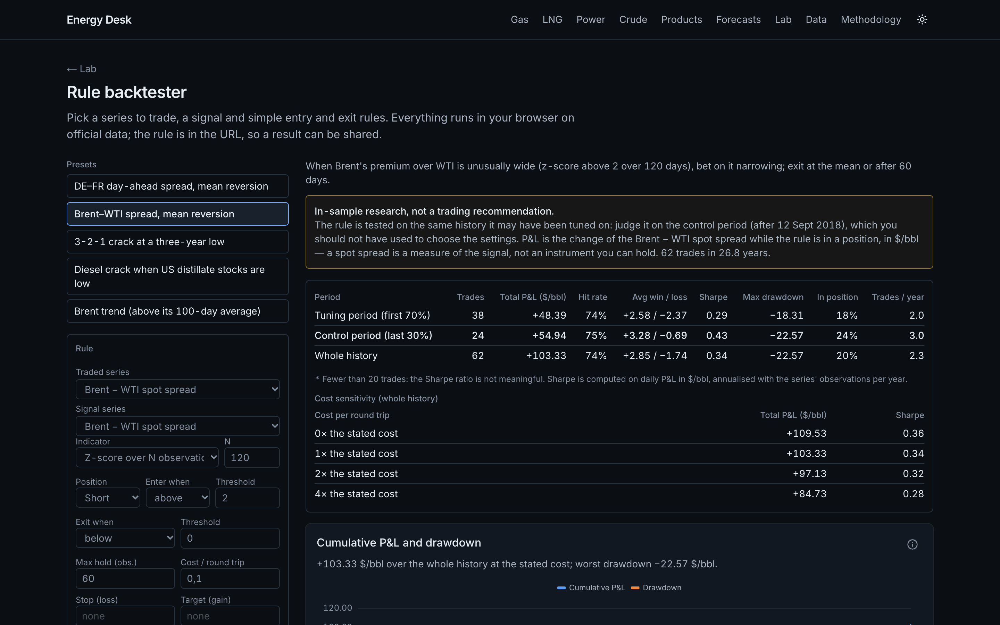

# Energy Desk

A public research site for European energy markets (gas, LNG, power) and global oil, built only on
free, official data. Every number shows its source, unit, licence and date, and can be traced back to
a stored observation. Missing data is shown as missing, never estimated.

**Live:** https://energy-desk-two.vercel.app



## What it does

- **Market pages** for European gas, LNG and power (Germany, France, Great Britain), crude oil and
  refined products. Each page answers a few desk questions, such as whether storage is tight for the
  season, where power is flowing, or whether a crack spread is unusually low. Each chart comes with a
  one-line takeaway, its source and its freshness.
- **Home:** a map of Europe (gas storage, power prices, diesel at the pump) and a world oil view, with
  a short "Today in energy" generated from fixed rules.
- **Forecasts:** three models (EU gas storage in 30 days, French daily power demand, US crude stocks).
  Every live forecast is stored before its outcome is known and can never be edited. Each model is
  scored against naive and seasonal baselines, and the site says plainly when a model has no edge.
- **Lab:** a rule backtester (the rule lives in the URL, trades execute the day after the signal, and
  the history is split into tuning and control periods) and a trade simulator based on a block
  bootstrap.
- **Data catalogue** (`/data`): every series with its source, unit, licence, coverage, gaps and
  freshness, plus the ingestion runs of the last 30 days.
- **[Methodology](https://energy-desk-two.vercel.app/methodology):** how each number is computed, and
  the licence of each source.

| Gas (light theme) | Forecast registry |
|---|---|
|  |  |
| **Power** | **Lab: rule backtester** |
|  |  |

## Data principles

- **Official, free sources only:** GIE AGSI+ and ALSI, ENTSOG, SMARD, RTE éCO2mix (ODRÉ), Elexon, EIA,
  the European Commission Weekly Oil Bulletin, CFTC, FRED, the ECB and Open-Meteo. Yahoo Finance
  futures appear only as derived indicators, always labelled "unofficial, delayed, research only".
- **Nothing is fabricated or filled in.** Gaps stay visible. Licensed data (ICE, CME, EEX, EPEX,
  Platts, Argus) is not used, and the corresponding views are shown as declared gaps.
- **Values are stored in their source units** and converted only through one units module. Spot and
  futures prices, or physical and paper prices, are never mixed in one spread.

## Architecture

```
 official APIs ──▶ worker (Python 3.12, GitHub Actions cron)
                     fetch · validate · store · ingest_runs · forecasts
                          │  service role (writes)
                          ▼
                  Postgres (Supabase, Frankfurt)
                     market.* tables ── web.* views
                          │  web_reader role (read-only)
                          ▼
                  Next.js 16 on Vercel (fra1)
                     server components · cached queries · ECharts
```

- **Web** (`apps/web`): Next.js with Cache Components, TypeScript strict, Tailwind and shadcn/ui, and
  ECharts loaded only when a chart scrolls into view. The map is an SVG rendered on the server
  (d3-geo).
- **Worker** (`worker/`): one module per source, a shared HTTP client with retries, pydantic configs,
  pure tested transforms, and a walk-forward forecast engine.
- **Database** (`db/migrations/`): numbered SQL migrations. The site can only read the `web` views.
- **Monitoring:** server errors are logged as JSON lines, and a `health` workflow checks the pages,
  data freshness, ingestion runs and the forecast registry every 6 hours.

Design decisions are recorded as [ADRs](docs/adr/). The full specification is in
[`BUILD_SPEC.md`](BUILD_SPEC.md), and progress is logged in [`docs/SESSION_LOG.md`](docs/SESSION_LOG.md).

## Run it locally

```bash
npm install
npm run dev                      # http://localhost:3000
npm run lint && npm run typecheck && npm run test
npm run test:e2e                 # Playwright

cd worker && uv sync && uv run pytest
uv run python -m worker.ingest --source gie_agsi --dry-run
```

The site needs `DATABASE_URL_READONLY` in `apps/web/.env.local`, and the worker needs the variables
listed in `worker/.env.example`. See [`CLAUDE.md`](CLAUDE.md) for every command, including the local
database. To refresh the screenshots, run `npm run screenshots`.

## Quality

CI runs lint, typecheck, unit tests (Vitest and pytest), the build and Playwright smoke tests on
desktop and phone widths, including a "no horizontal scroll" check on every page.

Lighthouse (mobile) on the live site, 31 Oct 2026: accessibility is 100 on every page, and
performance is 90 to 100 on most pages. Two exceptions:
- **`/data`** (88–89) renders all 318 series in one table.
- **LNG** (86–89) waits for its data to stream in. This wait is being investigated (see
  [Known limits](#known-limits)).

## Known limits

- European positioning (ICE COT) and exchange settlements are not shown, for licensing reasons.
- Live forecast scores need weeks (daily models) to months (weekly) before a verdict.
- On the live site, the data part of each page currently streams after about 3 s, even though the
  same build serves it in about 70 ms locally. The cause, specific to the hosting, is being
  investigated.

## Credits

Builds on ideas and code from the author's earlier project,
[oil-tracker](https://github.com/CorentinSTK/oil-tracker): EIA series IDs, the weekly seasonal norm
(ISO weeks, week 53 folded into 52) and the futures expiry rules used to rebuild generic months.

## Licence

Code: [MIT](LICENSE). Data shown on the site belongs to its sources and is used under each source's own
licence, listed on the [`/data`](https://energy-desk-two.vercel.app/data) and
[`/methodology`](https://energy-desk-two.vercel.app/methodology#licensing) pages. No exchange or
licensed data is redistributed.
